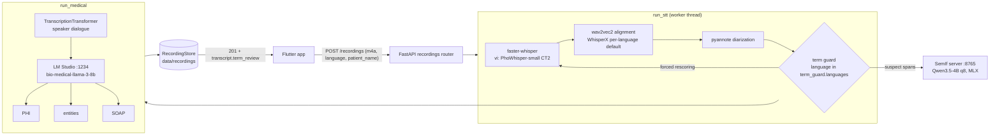
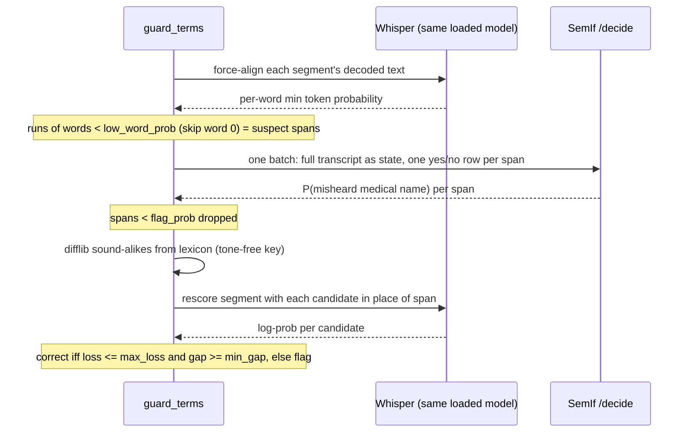

# ADR 010: Recording LLM Pipeline with a Local SemIf (OpenJev) Medical Gate

- **Date**: 2026-10-19
- **Status**: Accepted (PR #7, `feat/medical-term-guard`)
- **Scope**: the synchronous `/recordings` path the mobile app uses; the Temporal path is unchanged

## Context

Vietnamese ASR turns unfamiliar drug names into ordinary words ("metformin" → "men hormone").
The SOAP LLM then writes the wrong drug, or none, into the clinical note. A text-only model
can't repair this: asked to choose, Jev picked amlodipine (0.88) or metoprolol (0.86) over
metformin, because "huyết áp" (blood pressure) came next. The fix must use the audio.

## Architecture

Every model runs on the host. No transcript or audio leaves the machine.

| Component | Process | Model | Port | RAM (measured) |
|---|---|---|---|---|
| ASR + guard | API (`uvicorn`, worker thread) | PhoWhisper-small CT2 (vi), `base` (en) | 8000 | in API |
| Medical gate | `scripts/semif_server.py`, own venv | `Qwen/Qwen3.5-4B@851bf6e`, 8-bit | 8765 | ~5 GB |
| Medical LLM | LM Studio | `bio-medical-llama-3-8b` | 1234 | ~8.5 GB |

SemIf pins its own torch/transformers/MLX, so it runs in its own venv and talks HTTP.

## The medical gate (`app/services/term_guard.py`)

Each step uses only the evidence it actually has.

| Step | Evidence | Why this model |
|---|---|---|
| 1. Suspect | Whisper token probability of its own output | Only the acoustic model knows what it misheard |
| 2. Gate | SemIf typed-option probability, `misheard` vs `fine` | Meaning check; reads logits, no generation to parse |
| 3. Fix | Whisper forced rescoring of each lexicon candidate | Picks what was said, not what is plausible |

Lexicon: `data/vocab/vi_medical.txt` (VietMed-NER terms) + `data/vocab/drugs_who_eml.txt`
(499 WHO Essential Medicines). Match key drops tone marks, case, spaces, punctuation.

### Decision rule (`config.yaml` `term_guard:`)

| Key | Value | Meaning |
|---|---|---|
| `languages` | `[vi]` | Guard off for other languages |
| `low_word_prob` | 0.5 | Word below this is suspect |
| `flag_prob` | 0.5 | SemIf P(misheard) needed to review a span |
| `candidates` | 5 | Sound-alikes rescored per span |
| `max_loss` | 5.0 nats | Best term must fit the audio nearly as well as decoded words |
| `min_gap` | 5.0 nats | …and beat the runner-up by this much; otherwise flag only |
| `timeout_seconds` | 60 | SemIf request |

Corrections edit `segments[*].text` before `run_medical`, so the SOAP note sees the fixed
term. `words[]` timestamps keep the original tokens.

On CUDA, Whisper's encoder result is copied to CPU before NumPy batches
candidate texts for CTranslate2 alignment; a GPU StorageView has no NumPy view.

SOAP parsing accepts English and Vietnamese section labels and removes paired or
unmatched `**`/`__` emphasis markers from section content.

## Contract: `transcript.term_review`

| Field | Values | Consumer behaviour (app) |
|---|---|---|
| `status` | `ok` / `unavailable` / `error` | Non-`ok` shows an orange "check unavailable" card |
| `model` | e.g. `Qwen/Qwen3.5-4B@851bf6e-q8` | Audit trail of the gate model |
| `terms[].action` | `corrected` / `flagged` | Row: `"men hormone" → metformin` or "check against the audio" |
| `terms[].replacement` | term or `null` | Set only when corrected |
| `terms[].suggestions` | `[{term, score}]` | score = nats vs decoded words; app shows top 3 |
| `terms[].start/end` | seconds | Segment span for playback |

Field absent (English, older backends) → app shows no card.

## Failure modes

| Failure | Behaviour |
|---|---|
| SemIf down / timeout | `status: unavailable`; transcript untouched; pipeline continues |
| Guard exception | `status: error`; logged; pipeline continues |
| Token/word count mismatch in a segment | Segment skipped, warning logged |
| LM Studio step fails | That step (PHI, entities or SOAP) empty; others still run |
| Whole pipeline > `recordings.sync_timeout_seconds` (300) | 504; the worker thread still finishes in background |

## Measured behaviour

| Input | Result |
|---|---|
| Vietnamese dictation, AAC m4a upload | "men hormone" → metformin; SOAP "currently takes metformin"; ~68 s end to end |
| Same dictation, 16 kHz WAV upload | "hormone" flagged only; metformin not suggested |
| Synthetic drug list (bisoprolol, …) | 3 flagged, 0 wrong corrections |
| `vn-1.mp3` small talk | 0 flagged, 0 changed |

## Known limits

| Limit | Upgrade path |
|---|---|
| Thresholds set on one synthetic dictation; result depends on audio encoding | Tune on clinician-labelled real recordings |
| Errors Whisper is confident about pass through ("ta ra ke ta mo" for paracetamol) | Lexicon-wide rescoring or contextual biasing in decoding |
| Lexicon lacks brand names and non-EML drugs | Add a Vietnamese drug formulary list |
| SemIf server is MLX-only (Apple Silicon) | SemIf Torch backend for Linux/GPU hosts |
| Two local LLMs resident (~13.5 GB) | Serve the gate from LM Studio if it exposes token logprobs |
